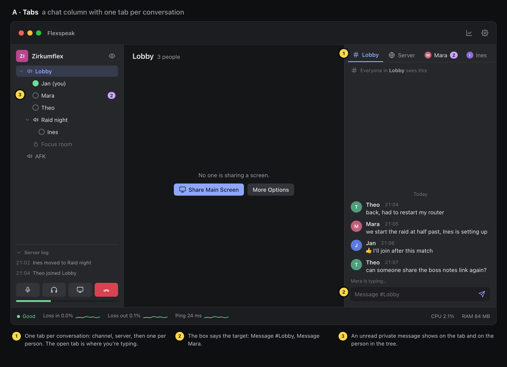
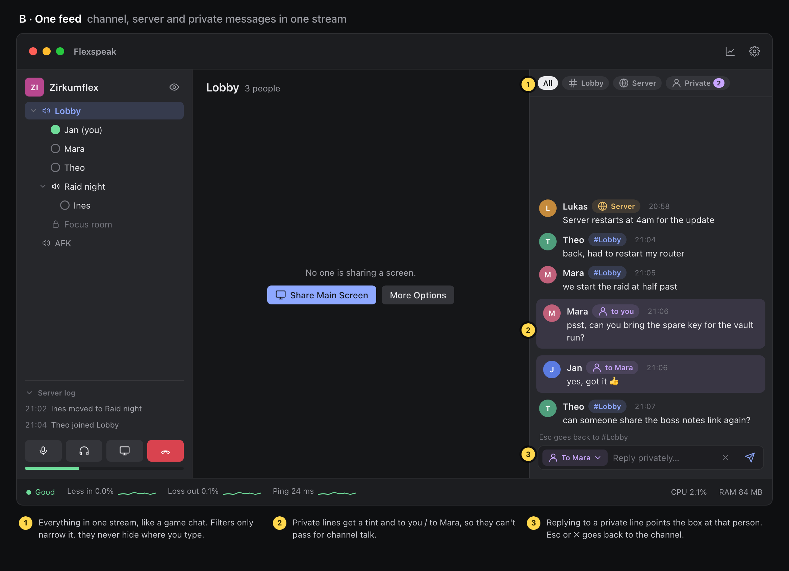
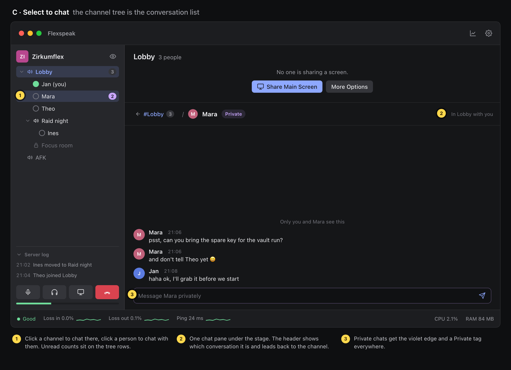

# Text chat: three layouts

TeamSpeak sends text to one of three places: **your channel**, **the whole server**, or **one person**. The goal is to show all three in one view without anyone wondering where a message came from or where theirs will go.

The mockups use the dark Flexspeak palette and the real connected layout (sidebar, stage, status bar). The colours are kept apart: channel is `accent` blue, private is a new violet, server is amber. They are HTML, not app code. To rebuild them, run `python3 docs/chat-proposals/build.py`, then render each `.html` at 1168 × 846.

## A · Tabs

A chat column to the right of the stage, with one tab per conversation: the channel, the server, then a tab for each person you're messaging. You see one conversation at a time, and the message box names it ("Message #Lobby", "Message Mara").

- **Good:** people already know it from TeamSpeak 3, Discord and Slack. A message can only go where you're looking.
- **Weak:** it takes about 350 pt from the stage, which matters while you watch a stream. With many private chats the tabs overflow. A private message in a tab you aren't on is easy to miss, which is why its badge also shows on the person in the tree.

## B · One feed

One stream with everything in it, like a game's chat box. Each line carries a tag (`#Lobby`, `Server`, `to you` / `to Mara`). Private lines are tinted violet. Filter chips at the top narrow the feed. Replying to a private line points the box at that person until you press Esc or ✕.

- **Good:** you never switch views, so nothing gets missed. It's the most compact of the three, and the column can shrink to a strip under a stream.
- **Weak:** it's the easiest to send a private message to the channel, or the other way round, because where you're typing changes with context. The tint and the "To Mara" chip work against that but can't rule it out. Busy servers make the feed noisy.

## C · Select to chat

There's no separate list of conversations: the channel tree is the list. Click a channel to chat there, click a person to message them, and click the server name for server chat. Unread counts sit on the tree rows. The chat opens under the stage, and its header shows which conversation it is, with a way back to your channel.

- **Good:** nothing new to learn and no second list of names. It fits the design system (panels, no boxes in boxes), and the stage keeps its full width. Clicking a person already selects them, so messaging is one click away.
- **Weak:** it shares height with streams, so while you watch, the chat has to fold to a bar or a pop-out. Selecting a person now changes the chat too, so ⌘-click selection and dragging must not switch it. Server chat is less visible.

## Recommendation

**C**, because it adds the least: the tree already holds everyone you can talk to, and the stage keeps its width for streams. Take two ideas from the others: A's rule that the message box always names its target, and B's violet tint for private messages wherever they show. If C feels too hidden in testing, A is the safe fallback. B is best kept as a compact "game overlay" mode later, not the default.

## Open questions

- Does chat history stay after a reconnect or a channel switch? TS3 servers keep none, and TS6 servers can keep it.
- With a stream on the stage, does C's chat fold to a one-line bar with the latest message, or pop out into its own window?
- Do pokes go into the private conversation, or stay their own dialog?
