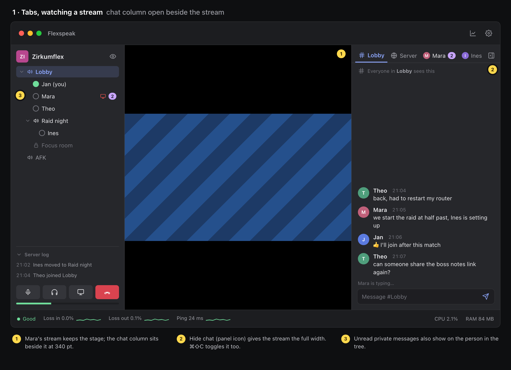
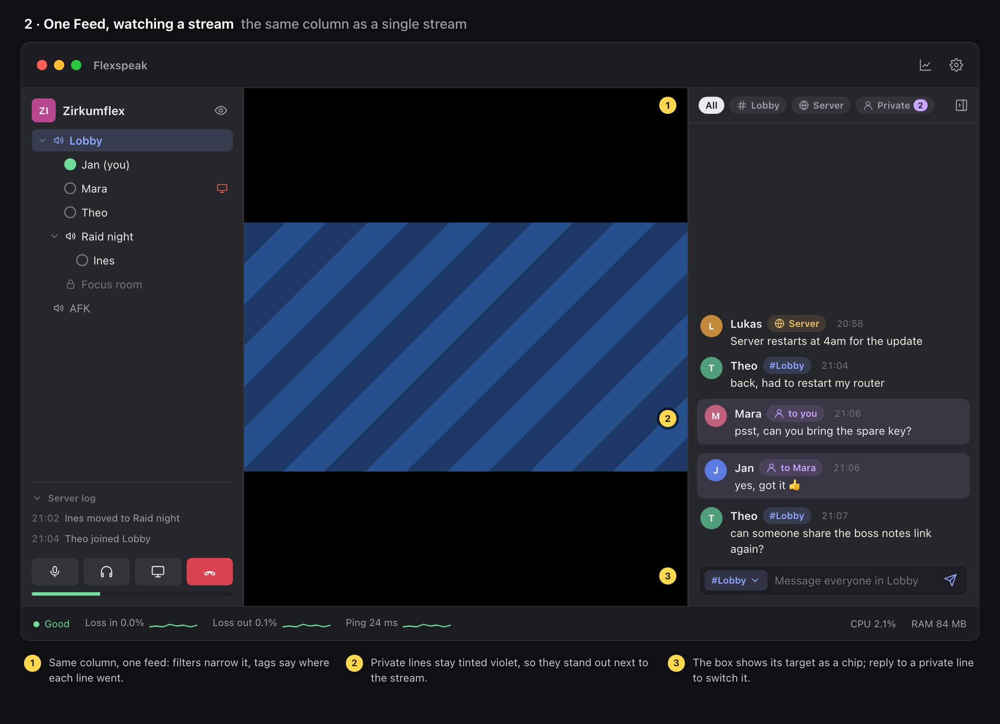
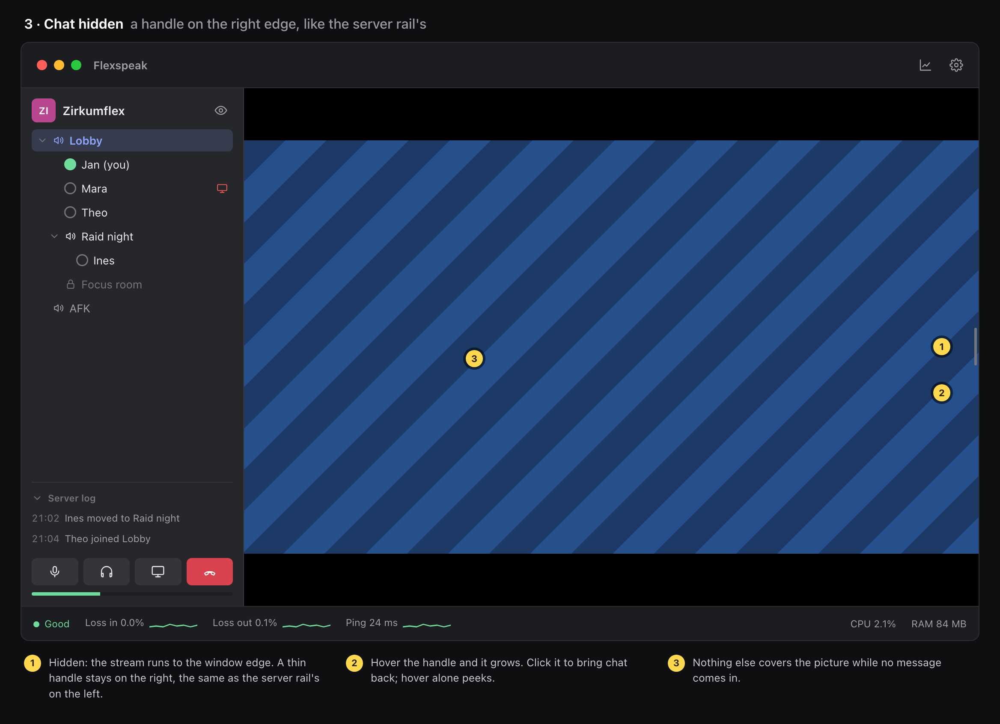
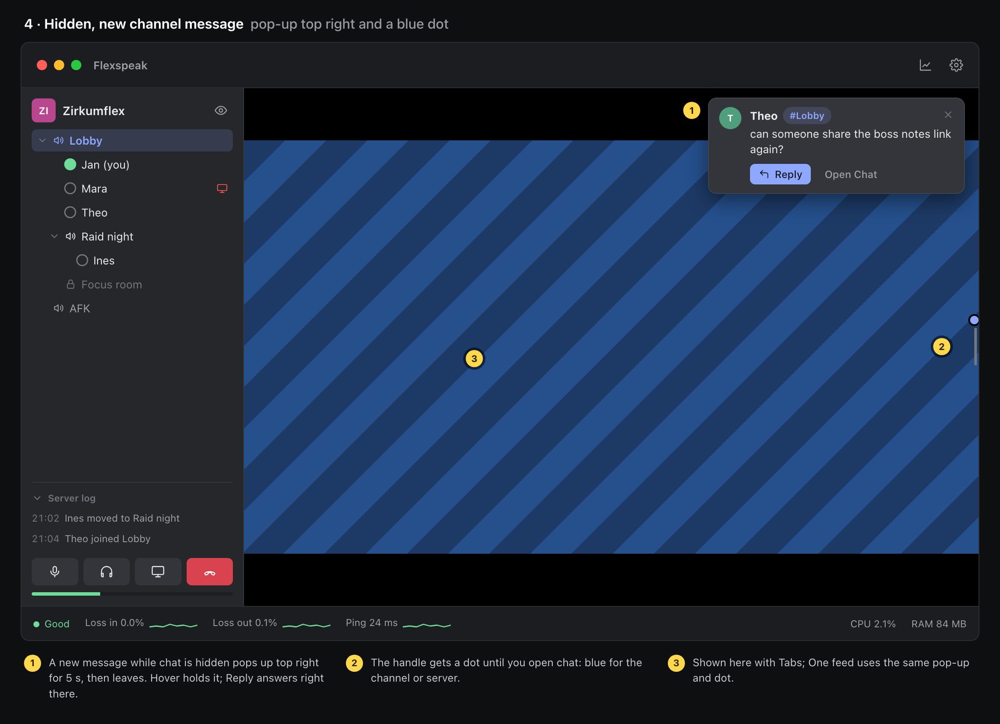
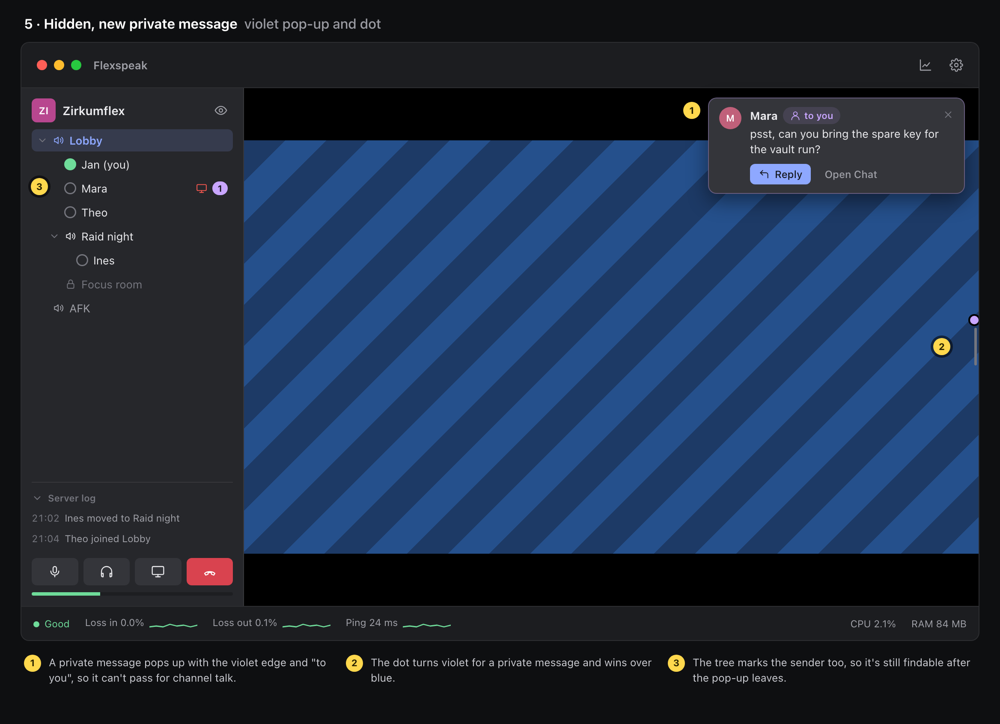
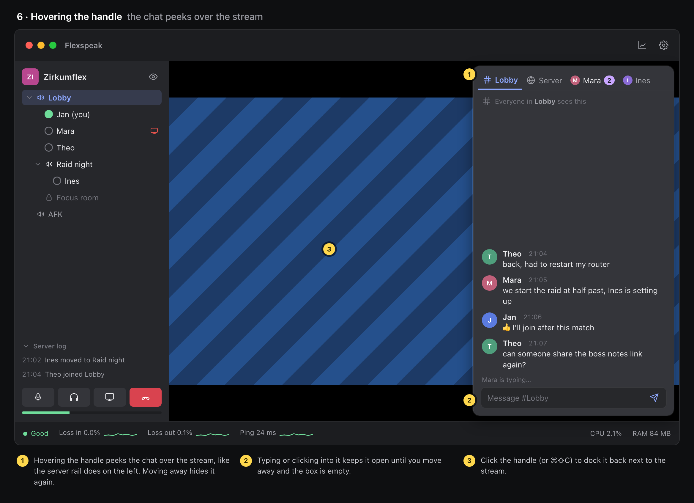
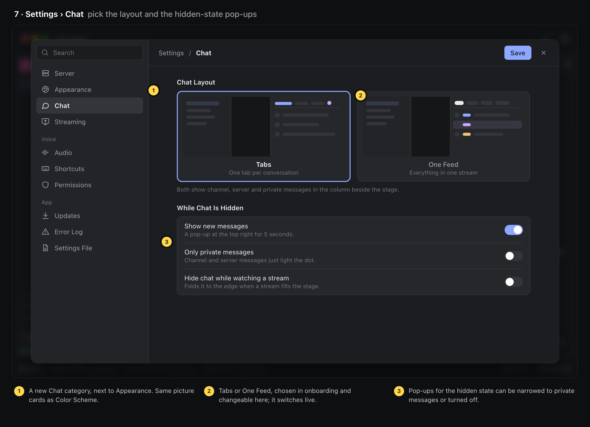
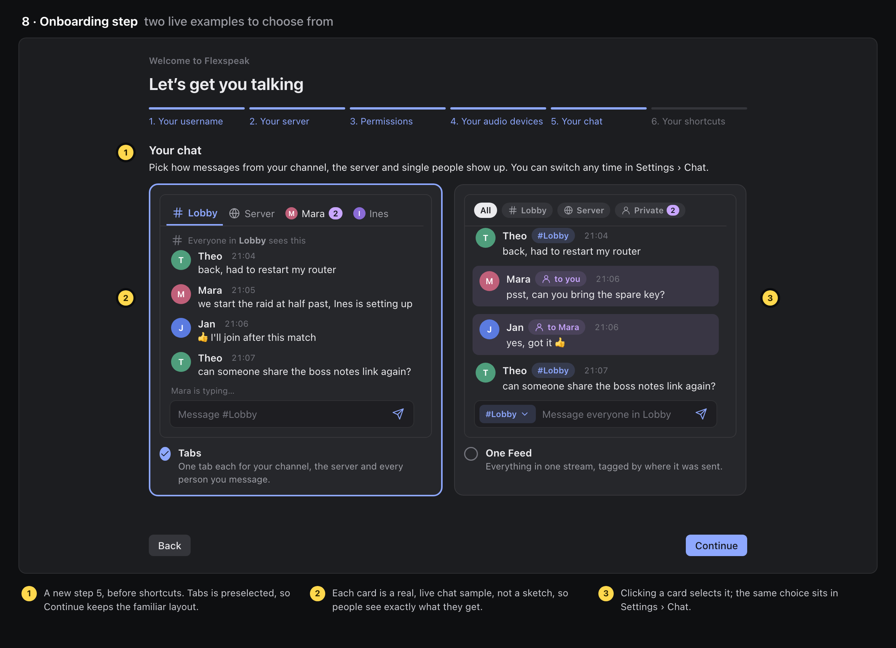
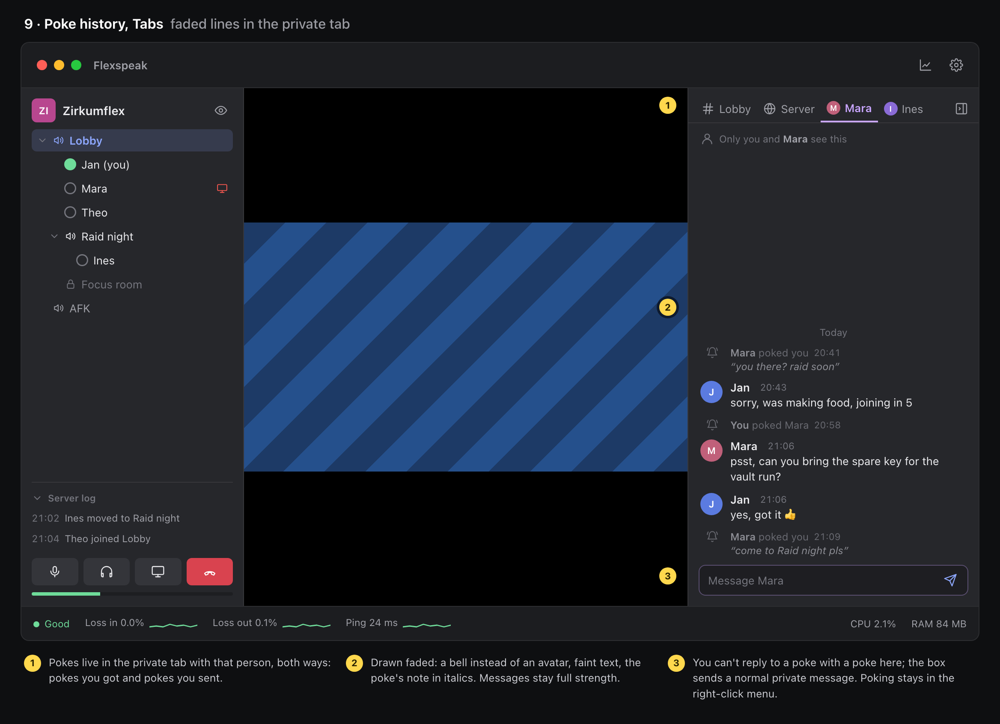
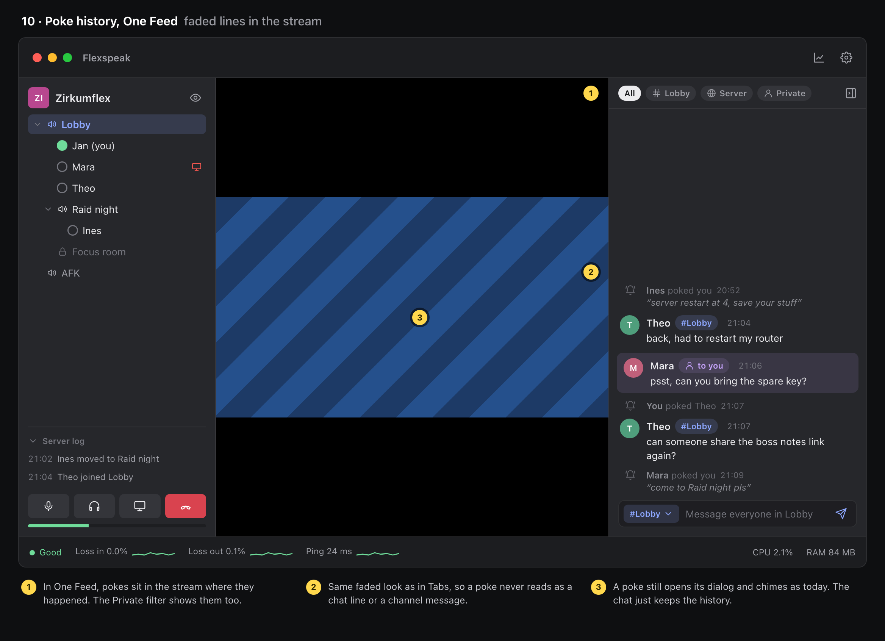

# Text chat: Tabs and One Feed

TeamSpeak sends text to one of three places: **your channel**, **the whole server**, or **one person**. Flexspeak shows all three in a chat column to the right of the stage. People pick between two layouts during onboarding and can change it later in Settings › Chat:

- **Tabs**: one tab each for the channel, the server and every person you message. You see one conversation at a time, and the box names where you're typing.
- **One Feed**: everything in one stream, each line tagged by where it went. Private lines are tinted violet. Replying to a private line points the box at that person until you press Esc.

The colours are the same everywhere: the channel is `accent` blue, private messages a new violet, the server amber.

The chat can be hidden. That leaves a thin handle on the window's right edge, the same as the server rail's handle on the left. Hovering it peeks the chat over the stage, and clicking it (or ⌘⇧C) docks the chat again. While the chat is hidden, a new message lights a dot on the handle and shows a pop-up at the top right for 5 seconds. The dot is blue for channel and server messages and violet for private ones.

Pokes are kept in the chat as history, both the ones you get and the ones you send. They're drawn faded: a bell instead of an avatar, faint text, and the poke's note in italics. In Tabs they go in the private tab with that person; in One Feed they sit in the stream (and under the Private filter). A poke still chimes and opens its dialog as it does today.

These are HTML mockups that use the dark Flexspeak palette and the real connected layout. To rebuild them, run `python3 docs/chat-proposals/build.py`, then render each `.html` at 1168 × 846.

## Screens

## Open questions

- Does chat history stay after a reconnect or a channel switch? TS3 servers keep none, and TS6 servers can keep it.
- Is ⌘⇧C free on every platform, and should it be editable in Settings › Shortcuts?
